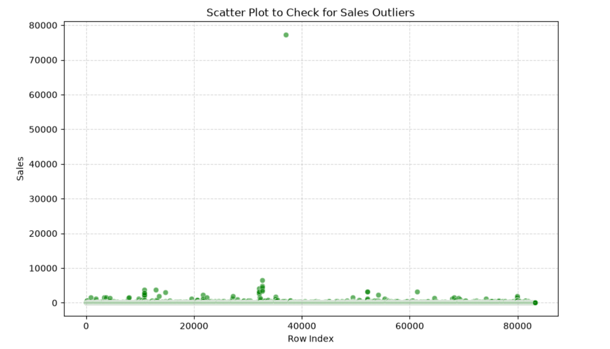
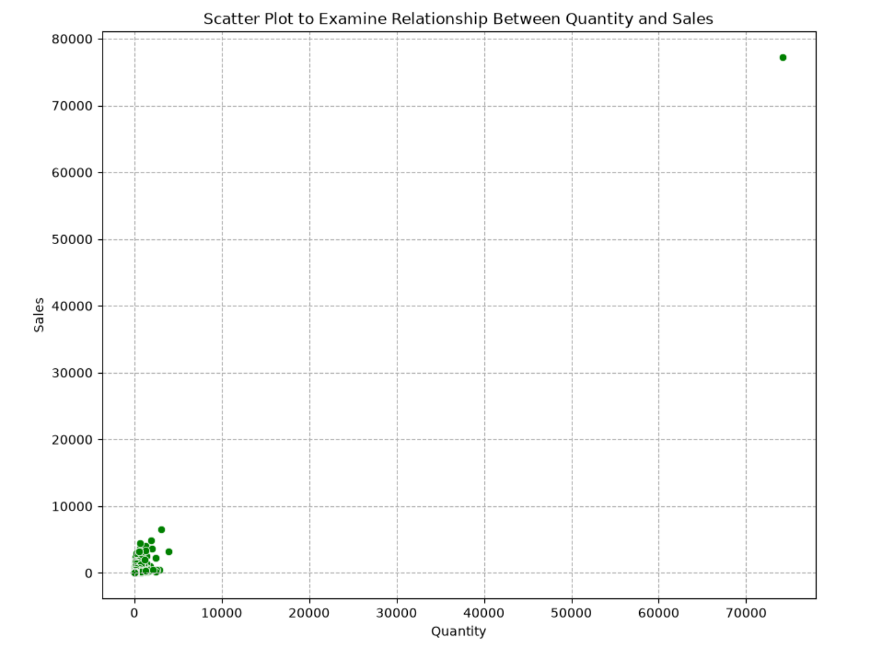
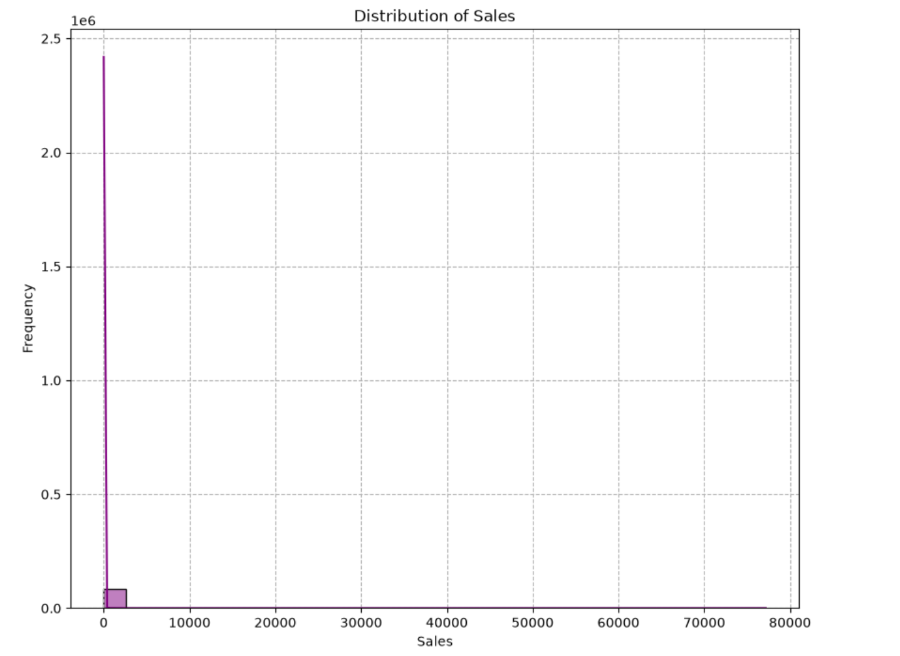
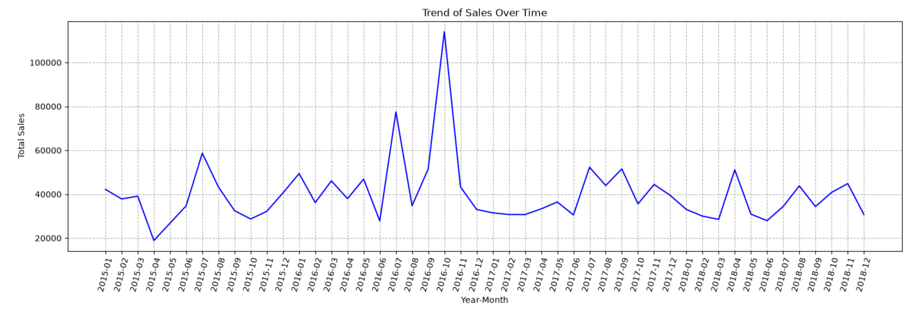
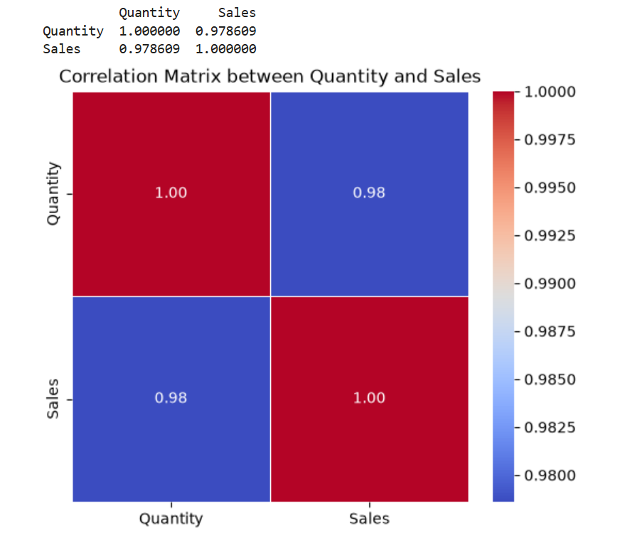

# Retail Sales EDA with Pandas, Matplotlib & Seaborn

Exploratory Data Analysis (EDA) of a retail transactions dataset (Jan 2015 – Dec 2018), built in a Microsoft Fabric notebook. The project covers loading and merging multiple tables, cleaning and descriptive statistics, outlier detection, visualisation, correlation analysis, and grouped/pivoted summaries.

## Dataset

An Excel workbook (`OnlineSalesRetailer1.xlsx`) with three sheets:

| Sheet | Columns |
|---|---|
| **Sales** | `InvoiceNo`, `StockCode`, `Quantity`, `UnitPrice`, `InvoiceDate` |
| **Invoice** | `InvoiceNo`, `Country` |
| **Product** | `StockCode`, `Description`, `Product_Category` |

After merging, the combined table has **83,277 transaction lines**.

## Tools & Libraries

Python 3.15, Pandas, Matplotlib, Seaborn, Microsoft Fabric notebooks.

## Approach

### 1. Load the data
Read each Excel sheet into its own DataFrame (`df_sales`, `df_invoice`, `df_product`) and previewed each one.

### 2. Basic cleaning and descriptive statistics
- Created a `Sales` column (`Quantity × UnitPrice`).
- Checked for missing values: **none found** in any column, so the `fillna(0)` step changed nothing.
- Checked for zero-price rows: **7 transactions have `UnitPrice = 0`** (and therefore `Sales = 0`), possibly free items or data-entry issues.
- Descriptive statistics:

| Column | Mean | Median | Mode | Std Dev |
|---|---|---|---|---|
| Quantity | 13.61 | 6 | 1 | 261.58 |
| UnitPrice | 3.08 | 1.95 | 1.25 | 5.18 |

The mean quantity is more than double the median and the standard deviation is huge, which points to a heavily right-skewed distribution with extreme values.

### 3. Merge the tables
Merged `Sales` with `Invoice` on `InvoiceNo`, then with `Product` on `StockCode`, giving one table with country and product category for every transaction.

### 4. EDA and outlier detection
- Ran `describe()` on the merged table. Date range is 2015-01-01 to 2018-12-31, max `Quantity` is 74,215 and max `Sales` is about $77,184.
- Filtered out `Quantity = 0`. No rows were removed because the minimum quantity is already 1.
- Plotted `Sales` by row index to spot outliers.

**Insight:** One transaction (about 74,215 units, roughly $77k in sales) sits far above all other transactions, which cluster close to zero.

### 5. Visualisations
- **Scatter plot: Quantity vs Sales** shows a tight cluster of ordinary transactions and the same extreme bulk order far off to the right.
- **Histogram: Sales distribution** shows most transactions have very small sales values, with a long right tail.
- **Line chart: monthly Sales trend** shows total sales per month (by `YearMonth`) from 2015 to 2018.

### 6. Correlation
- Pearson correlation between `Quantity` and `Sales` = **0.979**, a very strong positive relationship.
- This is expected, since `Sales = Quantity × UnitPrice` and unit prices are small and fairly uniform. Note that the extreme bulk order will inflate this figure.

### 7. Grouping and aggregation
- **Total sales by `Product_Category`** using `groupby`.
- A **pivot table** of sales by `Country` and `Product_Category`.

## Key Findings

- **Data quality is good overall:** no missing values, no zero or negative quantities. Only 7 zero-price lines were found.
- **Sales are extremely skewed:** a median quantity of 6 versus a maximum of 74,215, with one dominant outlier transaction.
- **Quantity drives sales:** correlation of 0.98 between quantity and sales value.
- **Top categories by total sales** (from the group-by output):

| Rank | Category | Total Sales |
|---|---|---|
| 1 | Uncategorized | ~191,283 |
| 2 | CHRISTMAS | ~88,029 |
| 3 | CANDLE | ~83,854 |
| 4 | GLASS | ~78,757 |
| 5 | MUG | ~70,059 |
| 6 | LIGHTS | ~65,517 |
| 7 | DECORATION | ~64,454 |
| 8 | SIGN | ~61,827 |

  The single largest "category" is **Uncategorized**, which suggests many products have no proper category assigned.
- **Country naming is inconsistent:** `AUS` and `Australia` appear as separate countries in the pivot output and should be merged.

## Limitations

- The outlier (74,215 units) was identified but **not removed or investigated**, so the histogram, scatter plot and correlation are all dominated by it.
- The pivot table was created with `pivot_table(values="Sales", index=[...])`, which defaults to the **mean** of `Sales`, not the total. It also has `Product_Category` as an index level rather than as columns.
- The notebook filters on `Quantity > 0`, but no negative or zero values exist, so no cleaning of returns or cancellations was needed or done.
- Only a single outlier-detection method (visual) was used.

## Possible Improvements

- **Investigate and handle outliers:** check whether the 74,215-unit order is a genuine bulk order or a data error, then re-run the charts with and without it (or use a log scale).
- **Fix the pivot table:** use `aggfunc="sum"` and put `Product_Category` in `columns`, with `fill_value=0`, to get a true "total sales by country and category" view. Add `margins=True` for totals.
- **Standardise country names** (e.g. map `AUS` → `Australia`) and check for other duplicates.
- **Improve product categories:** review the "Uncategorized" group and refine the category mapping.
- **Add business metrics:** monthly and yearly growth rates, top products, top countries, average order value, and a revenue-by-country chart.
- **Add statistical outlier checks:** IQR or z-score methods, and a boxplot.
- **Time-series depth:** seasonality analysis, moving averages, and year-over-year comparisons.
- **Use `.copy()`** when creating `df_filtered`, to avoid pandas `SettingWithCopyWarning` when adding the `YearMonth` column.
- **Consider Spearman correlation** or correlation after removing the outlier, since Pearson is sensitive to extreme values.
